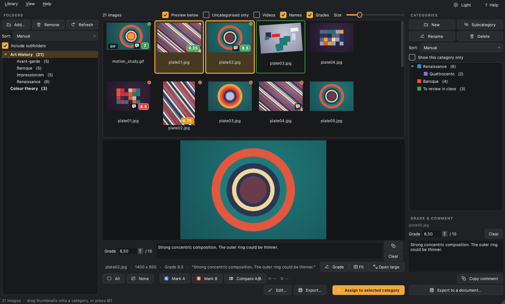
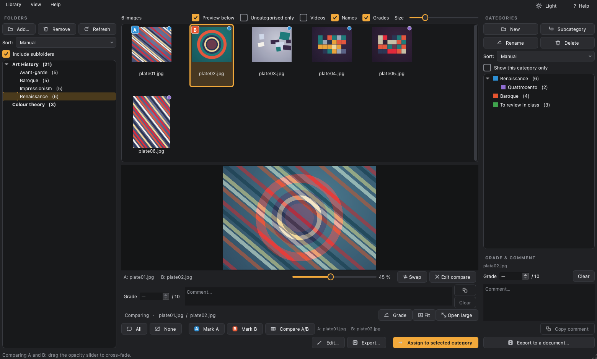
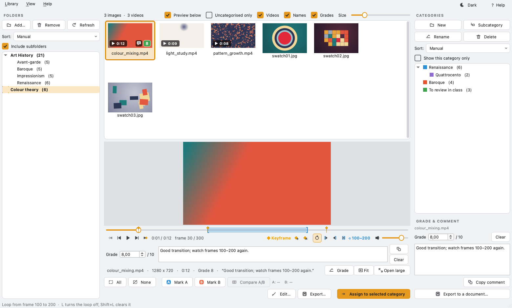
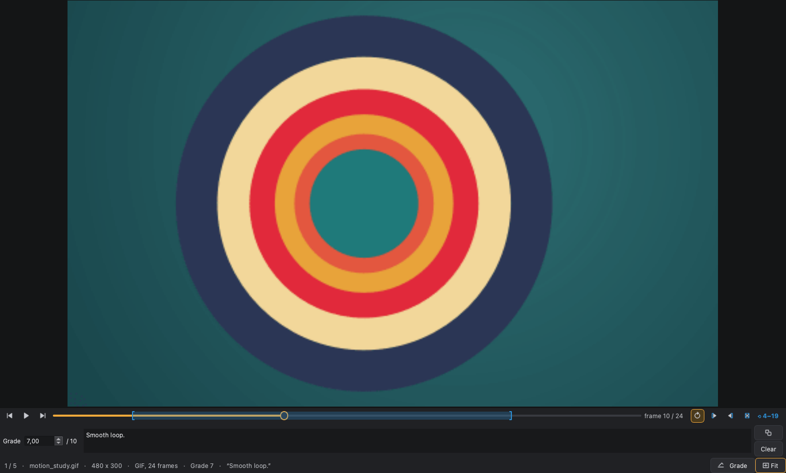
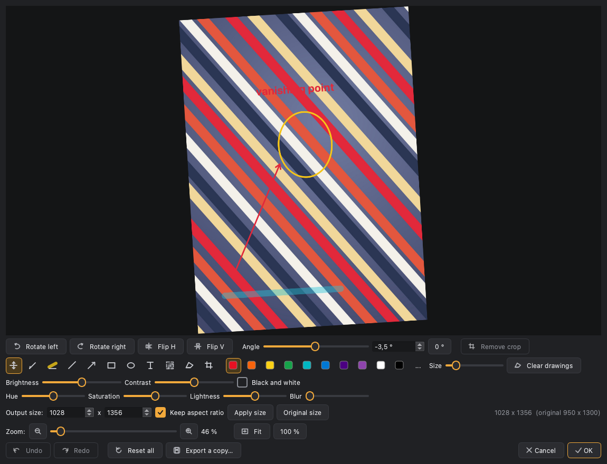

# DriloBoard - Image viewer and reviewer — manual en español

> El README público del proyecto está en inglés: [README.md](README.md).
> Este es el manual completo, que es como lo leo yo.

Tablero de imágenes para preparar material de clase: arrastras carpetas, ves
sus imágenes en miniatura, las clasificas en categorías propias, comparas dos
entre sí y las anotas encima.

**La interfaz del programa está en inglés**; estas instrucciones, en español.
Los nombres de botón van *en cursiva* tal y como aparecen en pantalla.

**Nada de esto toca tus archivos.** Ni las categorías, ni los recortes, ni los
dibujos: todo son instrucciones guardadas en `biblioteca.json` que se aplican
al vuelo. Una imagen puede estar en varias categorías a la vez, cualquier
edición se deshace meses después, y para obtener archivos ya editados está el
botón *Export*.



## Arrancar

**Versión portable (lo normal).** Descomprime
`DriloBoard-1.12.0-portable-win64.zip` donde quieras —disco, USB, carpeta de
red— y ejecuta `DriloBoard.exe`. No instala nada ni escribe en el registro.
La biblioteca y la caché de miniaturas se crean **dentro de esa misma
carpeta**, así que copiándola te llevas también toda la clasificación.

La primera vez Windows puede avisar de que el origen es desconocido (el
ejecutable no está firmado): *Más información* → *Ejecutar de todas formas*.

**Versión portable para Mac.** Descomprime
`DriloBoard-1.12.0-portable-macos.zip`: sale una carpeta `DriloBoard` con
`DriloBoard.app` dentro. Una sola app para Mac Intel y Apple Silicon, macOS 13
Ventura o posterior. Igual que en Windows, la biblioteca y la caché se crean
**en esa carpeta, junto a la app** (nunca dentro del `.app`), así que se puede
llevar en un USB.

La app no está notarizada por Apple, así que la primera vez macOS no la abre:
doble clic, cierra el aviso, y en *Ajustes del Sistema* → *Privacidad y
seguridad* pulsa *Abrir igualmente*. O, una sola vez, en Terminal:

```
xattr -dr com.apple.quarantine /ruta/a/la/carpeta/DriloBoard
```

Si macOS la ejecuta desde una copia temporal de solo lectura (lo hace con las
apps recién descargadas que aún llevan la marca de cuarentena), DriloBoard
guarda la biblioteca en `~/Library/Application Support/DriloBoard` para no
perderla; el comando de arriba lo evita. *Help* → *About DriloBoard* dice qué
archivo está usando.

En Mac los atajos con `Ctrl` son con `⌘` (`⌘1` … `⌘9`, `⌘Z`, `⌘T`…), rehacer es
`⇧⌘Z`, y los botones **Light / Dark** y **? Help** están abajo a la derecha,
porque el menú va en la barra de arriba de la pantalla.

**Desde el código fuente.**

- Windows: doble clic en `DriloBoard.bat`.
- Linux y macOS: `./driloboard.sh` (la primera vez crea el entorno solo).

## Volver a empaquetar

```
.venv\Scripts\python.exe -m PyInstaller DriloBoard.spec --noconfirm
```

Hace falta tener instalado también `PySide6-Addons`, que es el que trae el
vídeo; si falta, `DriloBoard.exe --selftest` lo detecta y devuelve 1.
Deja `dist/DriloBoard/` lista para comprimir. Antes de comprimir, borra
`dist/DriloBoard/cache/` si existe: la crea cualquier ejecución de prueba y no
pinta nada en el paquete. El icono se regenera desde el
propio código, no hay archivos de diseño sueltos.

En Mac, todo de una vez:

```
./build_macos.sh
```

Crea el entorno si hace falta, genera el icono `.icns` con `make_icns.py`,
empaqueta `dist/DriloBoard.app`, lo firma (ad hoc, o con tu certificado si
pones `CODESIGN_IDENTITY`), pasa el `--selftest` y deja
`dist/DriloBoard-<versión>-portable-macos.zip` con la carpeta portable y unas
instrucciones. Si el Python es universal2 (el de Apple o el de python.org) la
app sirve para Intel y Apple Silicon a la vez.

**Windows sin tener un PC con Windows.** Al publicar una release en GitHub,
el workflow `.github/workflows/windows.yml` la construye en una máquina
Windows de GitHub: pasa las pruebas, empaqueta, comprueba el `--selftest` y
sube `DriloBoard-<versión>-portable-win64.zip` a la release, con el LEEME de
`windows/LEEME.txt`. Para una release ya publicada, a mano:

```
gh workflow run windows.yml -f tag=v1.4.1
```

## Pasar las pruebas

```
.venv\Scripts\python.exe tests\correr_tests.py
```

Diecisiete suites que corren sin abrir ninguna ventana y usan su propio archivo de
estado, así que no pueden tocar tu `biblioteca.json`. Cubren, entre otras cosas, el mapeo de
coordenadas de recortes y dibujos en 14 combinaciones de transformaciones (y 9
más con giro libre), los dos temas, el marco azul de la selección, los
vídeos con sus fotogramas clave y el bucle, los GIF animados, las notas y
comentarios y su exportación a PDF, CSV y Word, y
—dos veces, contrastando marca de tiempo y tamaño— que ni editar ni exportar
modifican el archivo original.

## Ayuda dentro del programa

El botón **? Help** de arriba a la derecha (o la tecla `F1`) abre una guía con
todo lo que viene a continuación, en inglés como el resto de la interfaz. Se
queda abierta mientras trabajas, así que puedes ir siguiéndola.

## Cómo se usa

**Columna izquierda — Carpetas**
- Arrastra carpetas desde el Explorador (o botón *Add…*). Si sueltas un
  archivo, se añade su carpeta.
- Entre paréntesis va el número de imágenes de cada una.
- Selecciona varias con Ctrl/Mayús para ver sus imágenes juntas. Sin nada
  seleccionado se ven todas las carpetas.
- *Include subfolders*: cada carpeta principal (en negrita) pasa a ser un
  desplegable con las subcarpetas dentro, a cualquier profundidad. Se abren
  solas al marcar la casilla. El número de la principal es el total contando
  lo que hay dentro; el de cada subcarpeta, lo suyo.
  - Solo salen las subcarpetas que tienen imágenes; las ocultas se ignoran.
  - Al elegir una carpeta entran también sus subcarpetas. Elige una
    subcarpeta para ver únicamente ese tema.
  - *Remove* solo funciona sobre las carpetas principales.
- *Refresh* (o `F5`) relee el disco, por si añades imágenes con el visor
  abierto.
- **Sort**: *Manual* (arrastra las carpetas principales para colocarlas donde
  quieras), *A → Z* o *Z → A*. Arrastrar con un orden alfabético puesto vuelve
  solo a *Manual*. Las subcarpetas no se arrastran — su orden lo pone el
  disco — pero siguen el sentido elegido.
- El orden de esta columna manda en el de las miniaturas cuando tienes varias
  carpetas seleccionadas.

**Columna central — Miniaturas y vista previa**
- El deslizador *Size* va de 64 a 420 px.
- *Preview below* (o la tecla `V`) parte la columna en dos: las
  miniaturas arriba y la imagen seleccionada, grande, debajo. La divisoria se
  arrastra para dar más sitio a una u otra, y se recuerda al cerrar.
  - Basta con moverse por las miniaturas con las flechas: la de abajo va
    siguiendo la selección.
  - Rueda para zoom, arrastrar para mover, botón *Fit* o tecla `0` para
    reencuadrar.
  - Carga a **resolución completa**, así que puedes ampliar sobre un detalle
    sin que se emborrone. La decodificación va en segundo plano: mientras se
    abre una foto grande la ventana sigue respondiendo y el pie pone
    «opening…». Si pasas rápido de una imagen a otra, solo se carga la
    última.
  - Solo se reduce si la imagen pasa de 80 megapíxeles, para no agotar la
    memoria; en ese caso el pie lo avisa.
  - *Open large* abre la misma imagen a pantalla completa.
- **Comparar dos imágenes**: elige una miniatura y pulsa *Mark A* (o la
  tecla `A`); elige otra y pulsa *Mark B* (tecla `B`). Al marcar la segunda
  la comparación arranca sola: se superponen y aparece un deslizador de
  **opacidad**: a 0 % ves solo A, a 100 % solo B, y en medio la mezcla.
  - Las marcadas llevan una insignia **A** azul o **B** naranja en la
    esquina, así que siempre sabes cuáles son aunque estén lejos en la
    rejilla o en carpetas distintas.
  - Una imagen no puede ser A y B a la vez: marcar como B la que ya era A
    mueve la marca.
  - Las marcas **no se pierden** al navegar. Elegir otra miniatura cierra la
    vista de comparación, pero *Compare A/B* (tecla `C`) la relanza cuando
    quieras. *Clear the A/B marks* está en el clic derecho.
  - Atajo: si no hay marcas puestas y tienes exactamente dos seleccionadas,
    *Compare A/B* usa esas dos.
  - *Swap* cambia cuál va encima. *Exit compare* vuelve a la imagen suelta.
  - Si son de distinto tamaño, B se encaja dentro de A centrada y sin
    deformarse.
  - *Open large* se lleva la pareja y la opacidad tal cual.

  

- **Vídeos** (casilla *Videos*, **apagada por defecto**): al marcarla se buscan
  también mp4, mov, webm, mkv, avi… y entran en la rejilla con un distintivo
  ▶ y su duración. La casilla se recuerda al cerrar.
  - En la vista previa y en el visor grande el vídeo **abre en pausa**, para
    que no suene nada al pasar por las miniaturas. Debajo, play/pausa, barra
    para moverse (también en pausa, se ve el fotograma), tiempo y volumen. En
    el visor grande, `Espacio` reproduce y pausa.
  - Se clasifican en categorías igual que las imágenes, y *Export…* los copia
    tal cual. El editor y la comparación A/B son solo para imágenes: con un
    vídeo avisan en la barra de estado.
  - Quitar la casilla los esconde también de las categorías, pero no los
    desclasifica: al volver a marcarla siguen donde estaban.
  - **Fotograma a fotograma**: los botones a los lados de play, o `,` y `.`,
    retroceden o avanzan un fotograma (si estaba reproduciendo, pausa). Junto
    al tiempo sale el número de fotograma.
  - **Fotogramas clave**: `-` marca el fotograma actual, `Ctrl+,` y `Ctrl+.`
    saltan a la clave anterior o siguiente, y `Ctrl+-` borra la del fotograma
    en el que estás. Salen como rombos ámbar sobre la barra de tiempo, y un
    «◆ Keyframe» avisa cuando estás encima de una. Se guardan con la
    biblioteca (también al exportarla) y se deshacen con `Ctrl+Z`, sin que el
    vídeo vuelva al principio.
  - **Bucle**: el botón de bucle (o `L`) repite el vídeo entero. Para repetir
    solo un **tramo**, ve a su primer fotograma y pulsa `I`, luego al último y
    pulsa `O`: el tramo se pinta en azul sobre la barra de tiempo y la
    reproducción da vueltas dentro de él. `Shift+L` quita el tramo. El botón
    de bucle se mantiene al pasar de un vídeo a otro; el tramo es de cada
    vídeo y no se guarda.
  - La barra de tiempo va a todo el ancho y los botones, debajo.
  - Cada botón enseña su atajo en un bocadillo al dejar el ratón encima.
  - Desde el código fuente hace falta `pip install PySide6-Addons`; sin él la
    casilla sale desactivada y lo explica. La versión portable ya lo lleva.

  

- **GIF animados**: salen siempre (son imágenes, no hace falta casilla), con un
  distintivo **GIF** en la miniatura. En la vista previa y en el visor grande
  **se animan solos**; debajo, pausa/play, fotograma anterior y siguiente (o
  `,` y `.`, como en los vídeos), una barra para moverse por los fotogramas y
  el número del que ves. En el visor grande, `Espacio` lo para y lo reanuda.
  - **Bucle**: un GIF se repite de entrada, como en un navegador. El botón de
    bucle de su barra (o `L`) lo apaga, y entonces se para en el último
    fotograma; play lo vuelve a empezar. Para repetir solo unos fotogramas,
    `I` en el primero y `O` en el último, como en los vídeos; `Shift+L` quita
    el tramo.
  - Las ediciones se aplican a todos los fotogramas; el editor y la
    comparación A/B trabajan sobre el primero.
  - *Export…* copia tal cual un GIF sin editar (sigue animado). Uno editado
    sale como PNG de su primer fotograma.
  - Un GIF de un solo fotograma se ve como cualquier imagen, sin barra.
- **Doble clic en una imagen abre el editor** (un vídeo o un GIF, el visor
  grande). El visor grande se abre con *Open large*, bajo la vista previa:
  `←`/`→` pasan imágenes, rueda hace zoom, arrastrar mueve, `0` reencuadra,
  `F` o `F11` pantalla completa, `Esc` cierra.
- Clic derecho: abrir, abrir la carpeta contenedora, copiar ruta, asignar o
  quitar de categorías, poner nota o comentario.
- Las miniaturas seleccionadas llevan un **marco azul** bien visible.
- Los puntos de color en la esquina indican a qué categorías pertenece.
- *Uncategorised only* deja a la vista lo que aún no has clasificado.

**Columna derecha — Categorías**
- *New* crea al primer nivel; *Subcategory* crea dentro de la que tengas
  seleccionada. *Rename* / *Delete* (borrar no toca ninguna imagen del
  disco; si la categoría tiene subcategorías, se van con ella y el aviso te
  dice cuántas).
- **Se anidan**: arrastra una categoría **encima** de otra para meterla
  dentro, o **entre dos** para colocarla a ese nivel. No se deja meter una
  categoría dentro de sí misma ni de una hija suya.
  - El número de una categoría con hijas es el total contando lo que hay
    dentro; el desglose está en el tooltip. Una imagen que esté en la madre y
    en la hija se cuenta una vez.
  - Los nombres no se repiten en todo el árbol: son la clave con la que se
    guardan las asignaciones.
- Para asignar: arrastra las miniaturas seleccionadas sobre la categoría, o
  usa el botón *Assign to selected category*, o `Ctrl+1` … `Ctrl+9`
  para las nueve primeras.
- *Show this category only* convierte el centro en el contenido de esa
  categoría **y el de sus subcategorías**, vengan las imágenes de la carpeta
  que vengan.
- **Sort**: igual que en las carpetas — *Manual* arrastrando, o *A → Z* /
  *Z → A*, que ordena dentro de cada nivel sin deshacer el anidamiento. Ojo:
  `Ctrl+1` … `Ctrl+9` siguen el orden que veas de arriba abajo, subcategorías
  incluidas, así que reordenar cambia también los atajos.

**Columna derecha, abajo — Nota y comentario** (*Grade & comment*)
- Es del archivo que tengas elegido en la rejilla (el del foco): una **nota de
  0 a 10**, con decimales, y un **comentario** libre. Vale igual para imágenes,
  GIF y vídeos.
- `N` (o clic derecho ▸ *Grade / comment…*) te lleva a la casilla de la nota;
  `Tab` pasa al comentario. Se guarda solo al dejar de escribir un momento o al
  cambiar de archivo. *Copy comment* copia el texto del comentario al
  portapapeles, para pegarlo donde haga falta.
- La caja del comentario se agranda o achica arrastrando el **tirador** de
  cuatro puntitos que tiene debajo; doble clic la deja como siempre. El alto
  se recuerda y vale para todas las cajas del mismo sitio.
- **Banco de frases** (como Feedback 3000): botón *Phrases* bajo el comentario,
  `Ctrl+Shift+F` o *View ▸ Comment bank*. Tus frases hechas en dos columnas de
  tarjetas de color, con título y categoría. **Un clic en una tarjeta** y su
  texto va al comentario, donde esté el cursor (con doble clic, una sola vez; el
  banco te dice abajo dónde la ha puesto, o por qué no); si la frase lleva `{}`, te pide
  el dato (un número de plano, una fecha) al usarla. *Paragraph* hace punto y
  aparte.
  - Cada columna se filtra por categoría o con el buscador. Las tarjetas se
    arrastran para ordenarlas o pasarlas a la otra columna; el lápiz la edita,
    la papelera la borra. Marcando varias, se les cambia el color, la
    categoría o la columna, o se borran, de una vez.
  - Puedes tener varios **bancos** (uno por idioma, por asignatura) y
    **importarlos / exportarlos** en .json: los `feedback3000_ESP.json` y
    `_ENG.json` de Feedback 3000 se abren tal cual, y lo que exportas lo abre
    Feedback 3000.
  - Se abre en su propia ventana (con *Keep on top* no se esconde detrás); en
    la ventana grande sale a la derecha de la imagen. Escribe en el comentario
    que tocaste el último. Las frases se guardan en `frases.json`, junto a
    `biblioteca.json`.
- **Tiempo de corrección**: casilla **Time** arriba, junto a *Grades* (o
  *View ▸ Track marking time*). Viene apagado. Empieza a contar al hacer **clic o doble clic en un
  archivo**; si pasas a otro (con las flechas o en la ventana grande), el
  tiempo pasa a ese. **Tras 2 minutos sin tocar nada se para**, y cuenta solo
  hasta lo último que tocaste; al volver a tocar algo, sigue.
  - Abajo, el reloj: alumno (la carpeta), este archivo y el total del alumno.
    `⏸` lo pausa hasta el siguiente clic en un archivo. Un clic en `⏱` (o
    `Ctrl+Shift+T`, o *View ▸ Show the timer*) lo pliega en un icono para que
    no distraiga: sigue contando, con el punto rojo mientras cuenta.
  - *Library ▸ Marking time…*: el registro por alumno y por archivo, con el
    total, la media por alumno y lo de hoy. Puedes sumar o quitar minutos a
    un archivo (lo corregido en papel) y borrar tiempos. **Export…** lo guarda
    para analizarlo después, en cuatro formatos:
    - *Summary per student and file* (CSV): una fila por archivo y el total de
      cada alumno, con la nota y las horas en decimal.
    - *Every session* (CSV): una fila por sesión (día, hora de inicio y fin,
      minutos, cronometrada o a mano, nota). Lo mejor para tablas dinámicas.
    - *Report for Claude / Nexus* (Markdown): con propiedades de Obsidian
      (fechas DD-MM-AAAA) y tablas por alumno (media, mediana, mínimo y
      máximo), por día y por archivo, con las notas. Déjalo en la bóveda y
      pídele a Nexus o a Claude que lo analice.
    - *All the data* (JSON): todo, sesión a sesión.
  - Se guarda en `biblioteca.json`.
- **Nota media de la selección**: elige dos o más archivos y abajo, junto a
  los botones, sale la media y cuántos tienen nota (los que no, no cuentan);
  con el ratón encima, la más baja y la más alta.
- Sin nota se ve una raya: baja con la flecha por debajo de 0, o *Clear*, que
  borra nota y comentario.
- La nota sale en la miniatura, abajo a la derecha: **roja** por debajo de 5,
  **ámbar** hasta el 7 y **verde** de ahí arriba. Un bocadillo indica que hay
  comentario; al dejar el ratón encima de la miniatura se lee entero. La vista
  previa y el visor grande ponen la nota y el principio del comentario en el pie.
- `Ctrl+Z` deshace notas y comentarios como todo lo demás (por pausas al
  escribir, no letra a letra), y viajan con *Export library…*. Al importar
  fundiendo, tu nota y tu comentario no se pisan: solo se rellena lo que falte.
- **Desde el reproductor**: la vista previa y el visor grande llevan debajo de
  la imagen la misma barra de nota y comentario, que sigue al archivo que ves
  (también al pasar con `←` `→` en el visor grande). El botón *Grade*, junto a
  *Fit*, la muestra u oculta, y se recuerda; en el visor grande, `N` la abre y
  te lleva a la nota. Escribir en ella no pasa de imagen ni reproduce.
- **Exportar a un documento**: *Library* ▸ *Export grades and comments…* (o
  *Export to a document…* debajo del panel). Entran los archivos **que ves en la
  rejilla** y que tienen nota o comentario, en el mismo orden; elige el formato
  al guardar:
  - **PDF con miniaturas**: para leer o imprimir, con la media arriba.
  - **Hoja de cálculo (CSV)**: carpeta, archivo, nota, comentario y ruta, una
    fila por archivo. Con el sistema en español usa `;` y coma decimal, que es
    lo que espera Excel.
  - **Word (.docx)**: como el PDF, pero editable.
- **Ocultarlas**: quita la casilla *Grades* (junto a *Names*), o *View* ▸
  *Show grades and comments*, o `Ctrl+G`. Desaparecen de las miniaturas, los
  bocadillos, el pie de la vista previa, el visor grande y el panel; útil para
  proyectar en clase. No se borra nada: al volver a marcarla salen igual. Se
  recuerda al cerrar.
- **Corregir a ciegas**: marca la casilla *Blind* (junto a *Names*), o *View* ▸
  *Blind marking (hide file names)*, o `Ctrl+B`, y no se ve el nombre de ningún
  archivo en ninguna parte: ni bajo las miniaturas, ni en el pie de la vista
  previa y del visor grande, ni en el panel de nota, ni en el título del
  editor, ni en los bocadillos y avisos. Así el nombre del alumno no te
  condiciona al poner la nota. No se renombra nada, y no cambian los nombres
  de las **carpetas** ni lo que exportas (el PDF o el CSV de notas sí lleva los
  nombres, porque es para saber después de quién es cada nota). Se recuerda al
  cerrar: la próxima vez arranca en modo ciego hasta que lo quites.



## Importar y exportar la biblioteca

Menú **Library** ▸ *Export library…* guarda en un archivo `.driloboard` **toda
la información que has ido creando**: carpetas, categorías con su anidamiento,
qué imagen está en cada una, y las ediciones con sus dibujos. Las imágenes no
van dentro — solo la clasificación.

**Las rutas se guardan relativas a una carpeta raíz común**, así que el archivo
sirve en otro ordenador o después de mover las imágenes de sitio. Al importar,
si esa carpeta no existe aquí, DriloBoard te pregunta dónde están ahora y
reapunta la clasificación entera de un golpe.

*Import library…* te deja elegir:

- **Replace** — sustituye lo que tengas por lo del archivo.
- **Merge** — funde ambos. Las categorías con el mismo nombre se juntan en vez
  de duplicarse, y **tus ediciones no se pisan**: si una imagen ya tenía la
  tuya, se conserva y el resumen te dice cuántas se saltaron.

Si alguna imagen clasificada no aparece donde dice el archivo, se te avisa pero
**no se borra de su categoría**: quizá sea un disco externo que no está
enchufado ahora.

Todo esto se deshace con `Ctrl+Z` como cualquier otra cosa.

Para qué sirve en la práctica: llevarte la clasificación de casa al instituto,
tener una copia de seguridad de las horas de clasificar, o pasarle a un
compañero tu organización de un tema para que la use con sus propias copias de
las imágenes.

## Editar imágenes

**La edición es no destructiva: tus archivos originales nunca se tocan.** Lo
que se guarda en `biblioteca.json` es una receta por imagen (recorte, giro,
volteo, ajustes), que se aplica al vuelo a la miniatura y a la vista previa.
Cualquier edición se puede deshacer en cualquier momento, incluso semanas
después.



- **Editor** (botón *Edit…*, tecla `E`, o clic derecho ▸ *Edit*):
  - Rotar 90° a izquierda o derecha, voltear en horizontal y en vertical.
  - **Girar los grados que quieras** con *Angle*: deslizador, o el valor
    exacto en la casilla (positivo, en el sentido del reloj; `0 °` lo quita).
    Mientras giras aparece una **rejilla** para enderezar a ojo, y todo el
    giro cuenta como un solo paso de deshacer. Las esquinas que quedan al
    descubierto son transparentes (blancas al exportar a JPG); recorta
    después para quitarlas. Si ya había recorte, sigue centrado en el mismo
    punto de la imagen, y los dibujos giran con ella.
  - **Recortar**: elige *Crop* y arrastra un rectángulo sobre la imagen.
    Puedes volver a recortar sobre el resultado, y *Remove crop* devuelve
    el encuadre completo. El recorte se guarda en coordenadas del original,
    así que girar después no lo estropea. **Ampliar el encuadre**: arrastra
    el rectángulo más allá de los bordes de la imagen y el lienzo crece, con
    un margen transparente, blanco o negro (selector *Margin*).
  - Brillo, contraste y blanco y negro.
  - **Dibujar encima**, estilo Recortes de Windows: *Pen*, *Highlighter*
    (grueso y transparente, deja ver lo de debajo), *Line*, *Arrow*,
    *Rectangle*, *Ellipse* y *Text* (pinchas y escribes).
    - **Diez colores** a un clic: los ocho del arcoíris (rojo, naranja,
      amarillo, verde, cian, azul, añil y violeta) más blanco y negro. El
      botón `…` abre el selector completo si necesitas otro. Al lado, el
      grosor.
    - La *Eraser* borra **el dibujo entero sobre el que pinchas**, no raspa
      píxeles. Cada trazo es un objeto: puedes quitar la flecha y dejar el
      círculo.
    - Los dibujos se guardan en coordenadas del original, así que **siguen a
      la imagen**: si luego rotas o recortas, se rotan y se recortan con ella.
    - Van al final de la receta, por eso un rotulador rojo sigue rojo aunque
      pongas la imagen en blanco y negro.
    - `Ctrl+Z` deshace trazo a trazo. *Clear drawings* los quita todos (y
      también se deshace).
    - **Capas** (panel *LAYERS* a la derecha del editor), como en
      DriloReview: cada dibujo es una capa y la de arriba de la lista queda
      encima. El **ojo** la oculta (las ocultas no salen al exportar ni en
      los PDF); arrastrar reordena; las flechas (`Ctrl+]` / `Ctrl+[`) la
      suben o bajan; *Opacity* la vuelve transparente; la papelera o `Supr`
      la borran.
    - **Opacity** y **Hardness**, junto a *Size*: la opacidad y la dureza
      del siguiente trazo. Con menos dureza el borde se difumina como un
      aerógrafo (el centro sigue sólido). En el panel de capas se cambian las
      dos para el dibujo elegido.
    - **Colour layer**: tapa la imagen con el color elegido, a medias
      transparente, como una capa más. Dibuja encima para que tus marcas
      resalten; su opacidad (o esconderla) va en el panel de capas.
    - **Composition**: añade una guía de composición sobre el encuadre final
      (después de recortar o girar), ajustada a su proporción: regla de los
      tercios, centro, diagonales, rejilla áurea (phi), simetría dinámica
      (diagonales y recíprocas), triángulos áureos y espiral áurea en sus
      cuatro orientaciones. Toma el color y el grosor elegidos y es una capa
      más: ocúltala, cámbiale el color o la opacidad, o bórrala. Mientras se
      vea, sale también al exportar y en el PDF, para que el alumno la vea.
    - *Select and move* (el puntero): pincha un dibujo para elegirlo y
      arrástralo. Con uno elegido, un clic en un color se lo cambia; doble
      clic en un texto para corregirlo.
  - *Move and zoom* es el modo normal: arrastrar y hacer zoom sin pintar nada.
  - **Tamaño de salida** en píxeles, con proporción bloqueada si quieres.
    Recortar recalcula el tamaño, porque el que hubiera era para el encuadre
    anterior.
  - *Reset all* deja la imagen como estaba.
  - **Zoom**: deslizador, botones `−` / `+`, rueda del ratón, o `Ctrl` `+` /
    `Ctrl` `−`. *Fit* (tecla `0`) encaja la imagen en la ventana; *100 %*
    pone un píxel de la imagen final en un píxel de pantalla. Mover el brillo
    o el contraste no te cambia el zoom; rotar o recortar sí reencuadra,
    porque cambia la imagen.
  - El editor **abre al instante con una copia reducida y carga el original
    entero por detrás**. Mientras tanto el pie pone «afinando…»; en cuanto
    llega, lo que ves pasa a ser nítido aunque amplíes al 800 %, y el zoom no
    da un salto al cambiarse. Con imágenes de más de 80 megapíxeles se
    trabaja sobre una versión reducida, para no agotar la memoria.
  - **`Ctrl+Z` deshace** paso a paso dentro del editor (`Ctrl+Y` o
    `Ctrl+Mayús+Z` rehace). Un arrastre completo de un deslizador cuenta como
    un solo paso, no como cien.
- **Ediciones rápidas sin abrir el editor**: clic derecho ▸ *Edit* ▸ rotar o
  voltear. Se aplican a **todas las imágenes seleccionadas** de golpe, útil
  para enderezar una tanda de fotos.
- Las imágenes editadas llevan un **marco verde** en la rejilla, para que
  sepas que lo que ves no es lo que hay en el archivo.
- **Exportar** (botón *Export…*): eliges una carpeta y se escriben ahí las
  copias ya editadas, a resolución completa, con el nombre original. Nunca se
  pisa un archivo que ya exista — se numera. Esto es lo que te llevas a la
  presentación. El editor tiene además *Export a copy…* para una sola.
  El botón *Export…* abre un menú: *Images with the edits applied* (lo de
  arriba) o *PDF, one image per page*, que también está en el menú del botón
  derecho. El PDF lleva las imágenes seleccionadas con la edición aplicada,
  una por página, y marcas para añadir debajo el **nombre**, la **nota** y los
  **comentarios**. Con **The original next to the edited one**, cada archivo
  editado sale con la original al lado (o encima, si son apaisadas), cada una
  con su rótulo: *Original* / *Edited* (puedes cambiarlos): así
  el alumno ve el cambio. Vale también para el PDF por alumno y se recuerda.
- **Un PDF por alumno**: *Export…* ▸ *One PDF per folder (per student)*
  (también en el botón derecho y en *Library*). Elige la carpeta de la clase,
  con una subcarpeta por alumno: cada subcarpeta sale como
  `Nombre de la carpeta.pdf`, con todo lo que tenga dentro (también lo que esté
  en carpetas más hondas, como `intento_1`). Si hay varias imágenes
  seleccionadas, solo van esas. Si ya existe alguno, pregunta antes de
  sustituirlo.

## Tema oscuro o claro

El botón **Light / Dark** de arriba a la derecha, el menú *View* o `Ctrl+T`
cambian toda la aplicación, editor incluido. Se recuerda al cerrar; la
primera vez sigue al tema del sistema.

## Deshacer

`Ctrl+Z` deshace, `Ctrl+Y` (o `Ctrl+Mayús+Z`) rehace, y funciona en **toda la
ventana**, no solo al editar: ediciones, asignar y quitar imágenes de
categorías, crear, renombrar, borrar y anidar categorías, y añadir, quitar o
reordenar carpetas. Se guardan los últimos 40 pasos de la sesión.

- La barra de estado dice qué se ha deshecho («Undone: rotate right
  (12 images)»), para que no haya sorpresas.
- Borrar una categoría con subcategorías y deshacer las devuelve todas.
- La selección de imágenes se conserva al deshacer, para que puedas repetir
  sobre lo mismo.
- Las marcas A/B quedan fuera a propósito: deshacer una categoría no debería
  moverte la comparación que tenías montada.
- El historial es de la sesión: al cerrar el programa se pierde (lo hecho,
  no; eso está en `biblioteca.json`).

## Detalles

- Se guarda solo: carpetas, categorías, ediciones, dibujos, tamaño de
  miniatura, tema y posición de la ventana. En `biblioteca.json`, junto al programa — cópialo y llevas contigo
  toda la clasificación.
- Las miniaturas se cachean en la carpeta `cache\` del programa. Se puede
  borrar sin miedo: se regenera sola.
- **Límites pensados para bibliotecas grandes** (constantes al principio de
  `driloboard.py`, por si quieres tocarlos):
  - `THUMB_RAM_MB = 256` — tope de miniaturas en memoria. Al pasarlo se van
    soltando las que hace más que no miras. Sin esto, recorrer 10.000
    imágenes a 420 px se comía más de 4 GB.
  - `THUMB_QUEUE_MAX = 400` — peticiones de miniatura en espera. Se atiende
    primero lo último pedido, que es lo que tienes delante, y se descartan las
    de lo que ya has dejado atrás. Sin esto, saltar al final de una carpeta
    grande te hacía esperar a que se generaran todas las de en medio.
  - `CACHE_MAX_MB = 500` — tope de la caché en disco. Se poda al arrancar, en
    segundo plano, empezando por lo más antiguo; si borra algo te lo dice en
    la barra de estado. Además, al cambiar una edición se borra al momento la
    miniatura de la versión anterior.
- Formatos: los que soporte Qt — jpg, png, gif, bmp, webp, tiff, svg…
- Respeta la orientación EXIF de las fotos.
